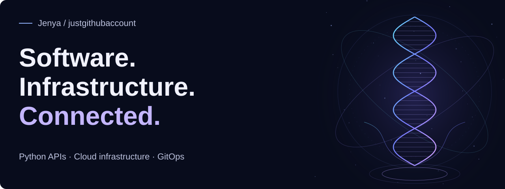
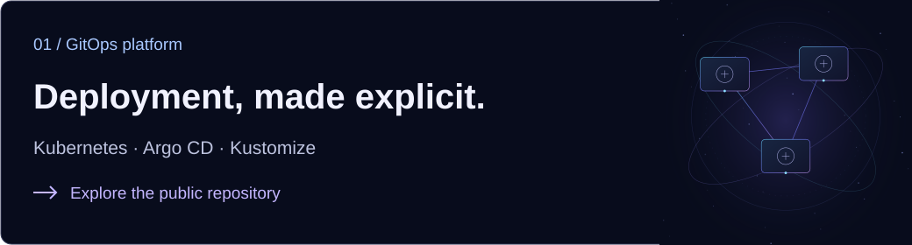
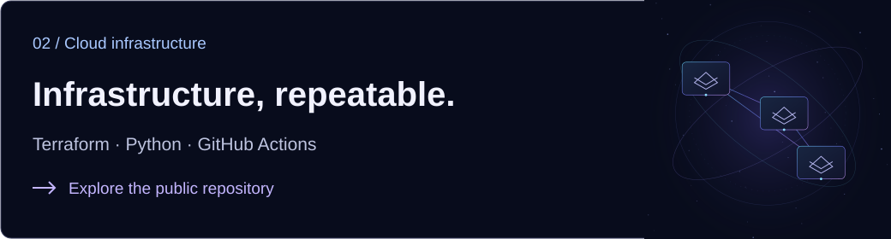
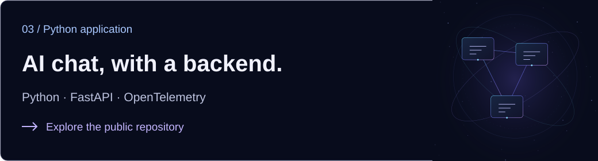

<!-- Generated by scripts/build.py. Edit data/public-portfolio.json. -->

<picture>
  <source media="(max-width: 600px)" srcset="assets/hero-compact.svg"/>
  
</picture>

# Hi, I’m Jenya.

From a working application to a repeatable delivery path. Explore my public engineering lab across Python APIs, cloud infrastructure and GitOps.

[Explore the portfolio](https://justgithubaccount.github.io/) · [Browse my GitHub](https://github.com/justgithubaccount)

## Selected public projects

Three parts of one engineering lab: application, infrastructure and delivery.

<a href="https://github.com/justgithubaccount/app-poly-gitops-k8s">
  <picture>
    <source media="(max-width: 600px)" srcset="assets/project-k8s-compact.svg"/>
    
  </picture>
</a>

Argo CD and Kustomize definitions connect applications, networking and observability. Separate development and smoke roots make the intended environments readable in Git.

Desired-state definitions in an engineering lab; no running cluster is implied.

[Read the source](https://github.com/justgithubaccount/app-poly-gitops-k8s/blob/8f4f31226fd591ad027750fd65e66385db58cb55/README.md) · Revision `8f4f31226fd5`

<a href="https://github.com/justgithubaccount/app-poly-gitops-infra">
  <picture>
    <source media="(max-width: 600px)" srcset="assets/project-infra-compact.svg"/>
    
  </picture>
</a>

Terraform provisioning and Argo CD bootstrap describe the route from cloud resources to application delivery. Bounded smoke and cleanup workflows make the lifecycle explicit.

Provisioning code and workflows; no currently running environment or billing guarantee is claimed.

[Read the source](https://github.com/justgithubaccount/app-poly-gitops-infra/blob/cb7c88f84e9f796e4725fc0a218fe68e3785a72e/README.md) · Revision `cb7c88f84e9f`

<a href="https://github.com/justgithubaccount/app-poly-gitops-fastapi">
  <picture>
    <source media="(max-width: 600px)" srcset="assets/project-fastapi-compact.svg"/>
    
  </picture>
</a>

A FastAPI service with project-scoped conversations, stored transcripts and OpenTelemetry instrumentation. Provider failures are handled separately from successful chat history.

Application code in an engineering lab; no hosted commercial service or customer results are claimed.

[Read the source](https://github.com/justgithubaccount/app-poly-gitops-fastapi/blob/899ba6434745390c44c6965a0ebe48f3515a7170/README.md) · Revision `899ba6434745`

## Engineering focus

These projects explore three connected engineering problems. Each one links to the implementation so you can inspect the decisions, boundaries and code.

- **Reviewable deployments.** Express the desired environment in Git, with explicit application and platform boundaries.
- **Repeatable environments.** Keep provisioning, bootstrap and cleanup steps visible instead of relying on undocumented setup.
- **Traceable AI applications.** Connect API behavior, conversation persistence and telemetry in one inspectable backend.

These are public code projects. Explore the repositories for setup requirements and implementation detail.
