# Anonymous orbital animation — study 002

> Isolated visual prototype. Not a profile, product, release, or deployed website.

## GitHub README image preview

<picture>
  <source media="(max-width: 640px)" srcset="./orbit-mobile.svg">
  
</picture>

This embedded image is the **GitHub Markdown rendering test**. Direct SVG file preview and README image rendering are different contexts. Whether GitHub's image proxy preserves animation must be observed in a real browser; a successful CI run cannot prove it.

[Desktop SVG](./orbit.svg) · [Mobile SVG](./orbit-mobile.svg)

## Local HTML preview

To test the full responsive standalone page, from the repository root run:

```sh
python3 -m http.server 8765 --bind 127.0.0.1 --directory experiments/anonymous-orbits
```

Open `http://127.0.0.1:8765/`. The HTML page switches between the wide and square SVG compositions at a 640px viewport. It is **not** deployed by this branch.

## Checks

```sh
python3 experiments/anonymous-orbits/check.py
```

The offline check validates XML, six neutral nodes per composition, CSS animation/reduced-motion declarations, local-only resources, the README image embed and separation from the generated portfolio. It cannot establish browser motion, GitHub image-proxy behavior or human visual acceptance.

- Desktop: three nested elliptical tracks, three independent orbital periods (42 / 30 / 20 seconds), six anonymous numbered nodes.
- Mobile: a square composition with six separated nodes, evenly phased around a 30-second cycle.
- Both: no JavaScript, third-party images, tracking or external network resources. `prefers-reduced-motion` produces stationary nodes.
- The preview uses only local assets; `index.html` includes `noindex,nofollow`.

This experiment must remain under `experiments/anonymous-orbits/`. Do not merge, publish, enable Pages or alter the public profile without separate operator authorization.
